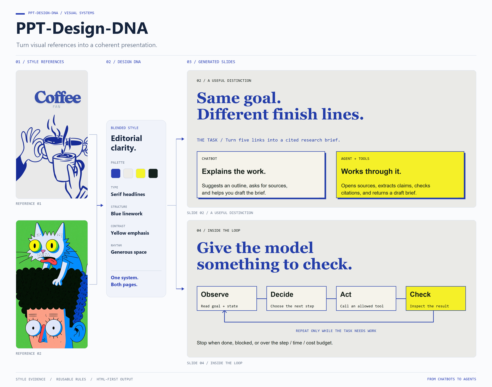
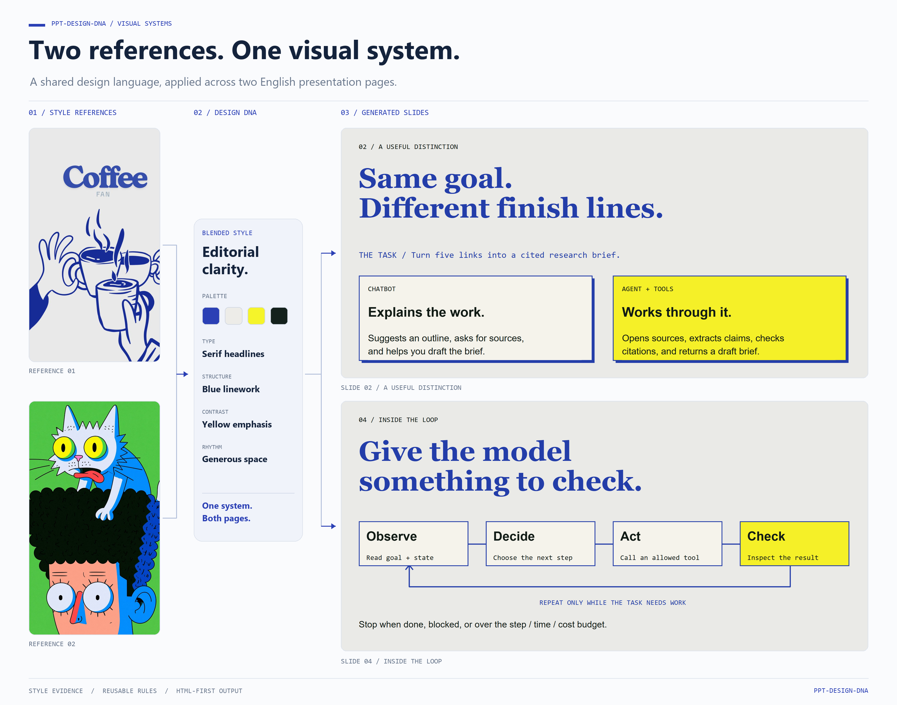

<h1 align="center">PPT-Design-DNA</h1>

<p align="center">Reusable visual systems for expressive presentations.</p>

<p align="center">
  <strong>English</strong> | <a href="README.zh-CN.md">简体中文</a>
</p>

<p align="center">
  <a href="#quick-start">Quick start</a> ·
  <a href="docs/showcase.md">Showcase</a> ·
  <a href="docs/architecture.md">Architecture</a> ·
  <a href="CONTRIBUTING.md">Contributing</a>
</p>



**PPT-Design-DNA** is an AI skill that turns reference imagery or a design brief into a visual system for HTML presentations. It captures composition, typography, color, texture, density, and motion as **Design DNA**, then applies those rules to the deck's content and audience.

Confirm the visual direction, refine its parameters, and generate a presentation. Save it as a versioned **Design Profile** when you want to reuse the style across future decks.

## Capabilities

| Capability | What it enables |
| --- | --- |
| Reference-based design | Extract a coherent visual language from one image or blend several references. |
| Design Discovery | Explore candidate visual directions from a written brief when no reference is available. |
| Reusable profiles | Explicitly save, version, compare, and reuse a design system. |
| Scenario adaptation | Adjust visual intensity and information density for reports, launches, courses, and portfolios. |
| Existing deck renovation | Inspect existing presentations and plan a redesign or conversion around the required content fidelity. |
| HTML-first delivery | Generate animated presentations on a fixed 16:9 stage, with optional PDF or PPTX export when supported. |
| Layout validation | Check declared content zones, spacing, and layout budgets before HTML delivery. |

Reference images supply **style evidence**. Images intended to appear on a slide are confirmed separately as content assets.

## Quick start

### 1. Install the skill

For a local Codex installation, clone the repository into your user skills directory.

**macOS / Linux**

```bash
mkdir -p "$HOME/.agents/skills"
git clone https://github.com/dakjdakd/PPT-Design-DNA.git "$HOME/.agents/skills/PPT-Design-DNA"
```

**Windows PowerShell**

```powershell
New-Item -ItemType Directory -Force -Path "$HOME/.agents/skills" | Out-Null
git clone https://github.com/dakjdakd/PPT-Design-DNA.git "$HOME/.agents/skills/PPT-Design-DNA"
```

If the skill does not appear, restart Codex. See the [setup guide](docs/getting-started.md) for requirements, project-scoped installation, and validation commands. Skill locations follow the [official Codex documentation](https://developers.openai.com/codex/skills/).

### 2. Choose a visual direction

Attach a reference image and start with:

```text
Use $PPT-Design-DNA with the attached reference image.
Extract its visual language and show me the Design DNA panel first.
Wait for my confirmation before collecting presentation requirements.
```

No reference image? Ask for Design Discovery:

```text
Use $PPT-Design-DNA.
Explore three visual directions for a restrained, editorial presentation
with sharp typography and a light background. Show the previews first.
```

### 3. Confirm and generate

After you confirm the Design DNA, the skill collects the topic, audience, slide count, content, output format, and image strategy through option-based questions. It then plans and generates the deck.

The primary deliverable is `outputs/<deck-slug>/index.html` in your working project. Saving a reusable profile is optional and requires your approval. Use a separate working project for generated presentations.

## How it works

```text
Reference images / Saved profile / Design Discovery
                         ↓
                    Design DNA
                         ↓
             Parameter panel + confirmation
                         ↓
        Presentation requirements + image strategy
                         ↓
              Scenario fit + optional adapter
                         ↓
          Design Contract → Blueprint → Page Specs
                         ↓
               HTML deck → Layout guard
                         ↓
               Delivery + optional export
```

Design DNA describes five layers: **Mood**, **Composition**, **Visual**, **Content Strategy**, and **Presentation**. A Design Profile preserves that system for reuse; a Design Adapter derives a variant for a particular scenario.

The workflow includes source-level layout checks. These check declared geometry and layout constraints; rendered visual quality still depends on the generated content and the host environment. See the [architecture guide](docs/architecture.md) for responsibilities and validation limits.

## Showcase

### Editorial Agents

Two references—a blue coffee illustration and a vivid character illustration—blend into one visual system for an English presentation, *From Chatbots to Agents*.

The result carries cobalt-blue serif headlines, warm neutral backgrounds, blue linework, and yellow emphasis across both a comparison page and an agent-loop diagram.



The composite uses content-area crops of the original screenshots. Browse the [case study](docs/showcase.md#editorial-agents) for both references and the original screenshots of slides 02 and 04. Earlier visual cases remain available in the [showcase archive](docs/showcase.md#pop-comic-consulting).

## Documentation

| Resource | Purpose |
| --- | --- |
| [Getting started](docs/getting-started.md) | Installation, workflow examples, outputs, and layout validation. |
| [Architecture](docs/architecture.md) | Repository structure, design concepts, and execution boundaries. |
| [Showcase](docs/showcase.md) | Reference-to-presentation case studies. |
| [Contributing](CONTRIBUTING.md) | Naming, documentation, and validation conventions. |
| [Skill entry point](SKILL.md) | Instructions consumed by the AI host. |

## Repository structure

```text
PPT-Design-DNA/
├── README.md                 # English project overview
├── README.zh-CN.md           # Simplified Chinese project overview
├── CONTRIBUTING.md           # Contribution guidelines
├── LICENSE                   # Apache License 2.0
├── .editorconfig             # Editor conventions
├── .gitignore                # Local and generated file exclusions
├── SKILL.md                  # Skill entry point
├── agents/                   # Host metadata and invocation policy
├── references/               # Workflow rules and design contracts
├── scripts/                  # Source-level layout validator
└── docs/                     # User and contributor documentation
    └── media/                # Documentation images, grouped by case
```

## Contributing

Improvements to design rules, documentation, and reproducible layout checks are welcome. Read the [contribution guide](CONTRIBUTING.md) before opening an issue or pull request.

## License

Licensed under the [Apache License 2.0](LICENSE).
