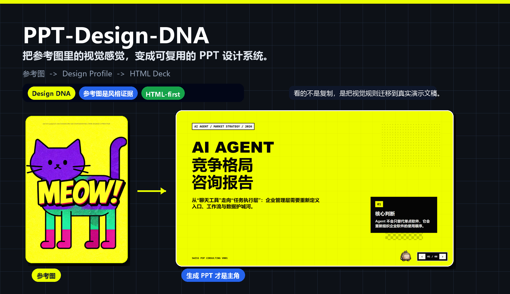
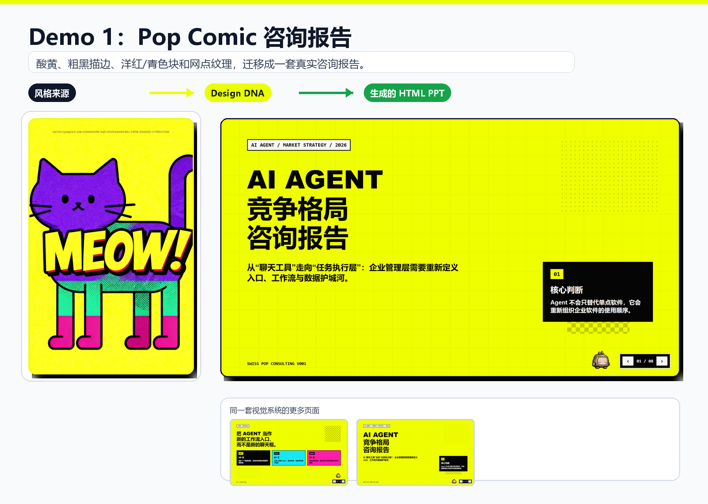
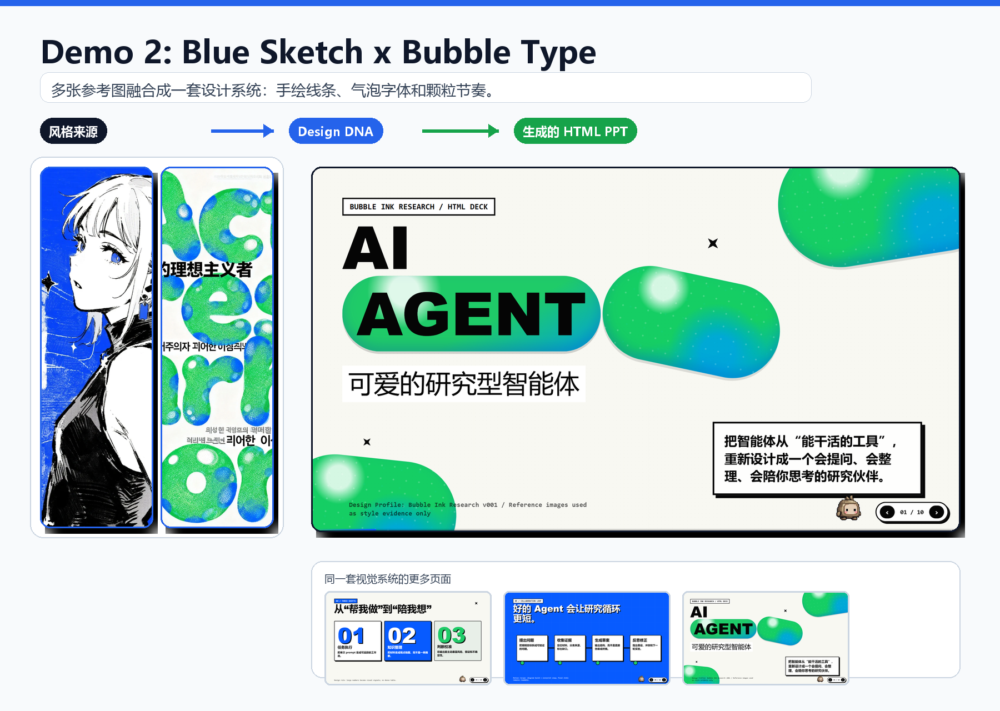

<h1 align="center">PPT-Design-DNA</h1>

<p align="center">为有表现力的演示文稿，建立可复用的视觉系统。</p>

<p align="center">
  <a href="README.md">English</a> | <strong>简体中文</strong>
</p>

<p align="center">
  <a href="#快速开始">快速开始</a> ·
  <a href="docs/showcase.md">视觉案例</a> ·
  <a href="docs/architecture.md">项目架构</a> ·
  <a href="CONTRIBUTING.md">参与贡献</a>
</p>



**PPT-Design-DNA** 是一个面向 HTML 演示文稿的 AI Skill。它从参考图或设计描述中提取构图、字体、颜色、纹理、信息密度与动效，形成 **Design DNA**，再根据内容和受众将这套视觉规则应用到整份演示文稿。

你可以先确认视觉方向、调整参数，再生成演示文稿。需要长期复用时，将它保存为可版本化管理的 **Design Profile**，用于后续项目。

## 核心能力

| 能力 | 用途 |
| --- | --- |
| 参考图驱动设计 | 从单张图提取视觉语言，或融合多张参考图形成统一风格。 |
| Design Discovery | 没有参考图时，从设计描述出发探索候选视觉方向。 |
| 可复用设计资产 | 按用户选择保存、版本化、比较和复用设计系统。 |
| 场景适配 | 为报告、发布会、课程和作品集调整视觉强度与信息密度。 |
| 既有演示文稿改造 | 检查原有内容，按保真要求规划美化、重设计或转换。 |
| HTML-first 交付 | 在固定 16:9 舞台上生成带动效的演示文稿；环境支持时可按需导出 PDF 或 PPTX。 |
| 布局校验 | 在 HTML 交付前检查声明的内容区域、间距与布局预算。 |

参考图用于提供**风格依据**；实际出现在页面里的图片，会单独确认为内容素材。

## 快速开始

### 1. 安装 Skill

在本地 Codex 环境中，将仓库克隆到用户级 skills 目录。

**macOS / Linux**

```bash
mkdir -p "$HOME/.agents/skills"
git clone https://github.com/dakjdakd/PPT-Design-DNA.git "$HOME/.agents/skills/PPT-Design-DNA"
```

**Windows PowerShell**

```powershell
New-Item -ItemType Directory -Force -Path "$HOME/.agents/skills" | Out-Null
git clone https://github.com/dakjdakd/PPT-Design-DNA.git "$HOME/.agents/skills/PPT-Design-DNA"
```

如果 Skill 没有出现，请重启 Codex。环境要求、项目级安装和校验命令见英文[使用指南](docs/getting-started.md)。安装路径依据 [Codex 官方文档](https://developers.openai.com/codex/skills/)。

### 2. 确定视觉方向

上传参考图后，可以这样开始：

```text
使用 $PPT-Design-DNA，根据附上的参考图提取视觉语言。
先展示完整的 Design DNA 参数面板，等我确认后再收集演示文稿需求。
```

没有参考图时，可以先探索设计方向：

```text
使用 $PPT-Design-DNA。
我想要克制的编辑设计风格、鲜明的字体层级和浅色背景。
请先做 Design Discovery，展示三个候选方向的视觉预览。
```

### 3. 确认并生成

确认 Design DNA 后，Skill 会通过选项式提问收集主题、受众、页数、内容、输出格式和图片策略，再规划并生成演示文稿。

主要交付文件位于工作项目的 `outputs/<deck-slug>/index.html`。保存为可复用 Profile 是可选操作，需要你明确同意。请在独立工作项目中生成演示文稿。

## 工作流程

```text
参考图 / 已保存 Profile / Design Discovery
                    ↓
               Design DNA
                    ↓
              参数面板与用户确认
                    ↓
             演示文稿需求与图片策略
                    ↓
           场景适配与可选 Design Adapter
                    ↓
     Design Contract → Blueprint → Page Specs
                    ↓
           HTML 演示文稿 → Layout guard
                    ↓
                交付与可选导出
```

Design DNA 包含 **Mood（情绪）**、**Composition（构图）**、**Visual（视觉）**、**Content Strategy（内容策略）** 和 **Presentation（演示方式）** 五层。Design Profile 保存可复用的设计系统，Design Adapter 为具体场景生成适配变体。

流程包含源代码级布局检查，用于验证已声明的几何关系与布局约束。最终视觉质量仍取决于生成内容和运行环境。模块职责与检查边界详见英文[架构说明](docs/architecture.md)。

## 视觉案例

### Pop Comic Consulting

将酸黄配色、粗描边和网点纹理转化为 AI Agent 策略报告的视觉系统。



### Blue Sketch × Bubble Type

融合手绘线条、蓝色强调、绿色气泡造型和颗粒质感，为研究分享建立统一的视觉语言。



独立参考图与完整页面图片见[案例详情](docs/showcase.md)。现有案例保留中文演示内容，英文版概览图提供英文的设计过程说明。

## 文档导航

以下详细文档以英文维护。

| 文档 | 内容 |
| --- | --- |
| [Getting started](docs/getting-started.md) | 安装、使用示例、输出文件与布局校验。 |
| [Architecture](docs/architecture.md) | 目录职责、核心概念与执行边界。 |
| [Showcase](docs/showcase.md) | 从参考图到演示文稿的视觉案例。 |
| [Contributing](CONTRIBUTING.md) | 命名、文档维护与验证约定。 |
| [Skill entry point](SKILL.md) | AI 宿主读取的执行说明。 |

## 项目结构

```text
PPT-Design-DNA/
├── README.md                 # 英文项目主页
├── README.zh-CN.md           # 简体中文项目主页
├── CONTRIBUTING.md           # 贡献指南
├── LICENSE                   # Apache License 2.0
├── .editorconfig             # 编辑器约定
├── .gitignore                # 本地与生成文件排除规则
├── SKILL.md                  # Skill 入口
├── agents/                   # 宿主元数据与调用策略
├── references/               # 工作流规则与设计契约
├── scripts/                  # 源代码级布局校验工具
└── docs/                     # 用户与贡献者文档
    └── media/                # 按案例归档的文档图片
```

## 参与贡献

欢迎改进设计规则、文档和可复现的布局检查。提交 Issue 或 Pull Request 前，请阅读英文[贡献指南](CONTRIBUTING.md)。

## 许可证

本项目采用 [Apache License 2.0](LICENSE)。
