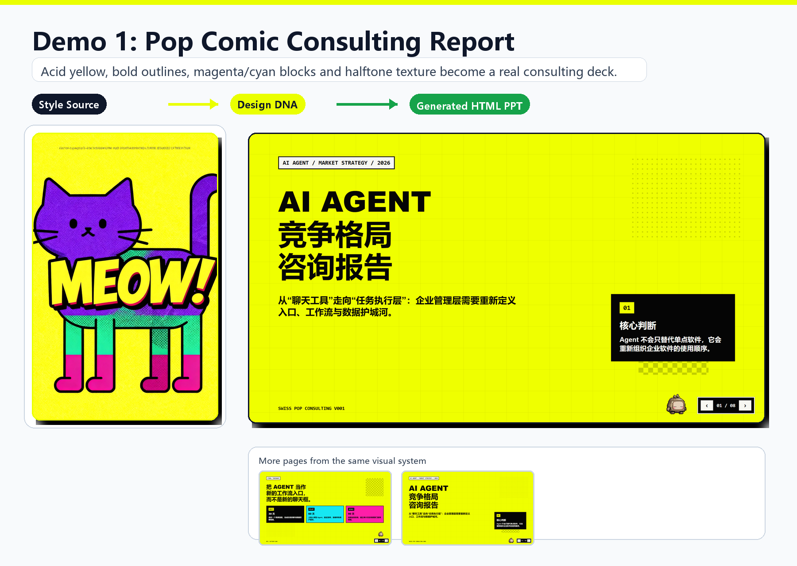
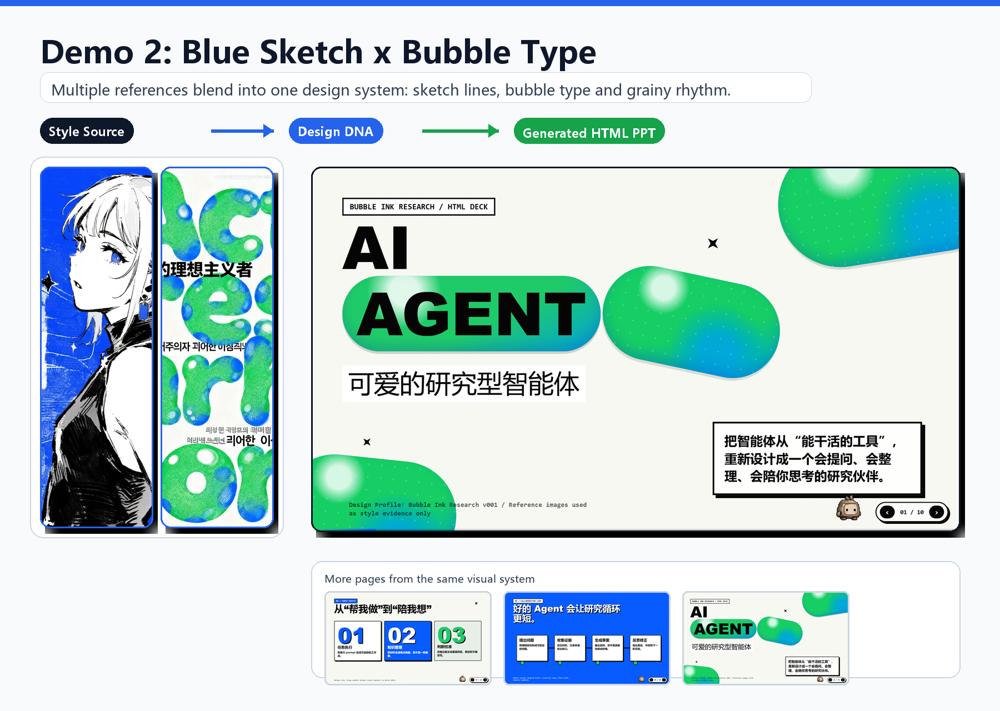

# Showcase

[Project overview](../README.md) · [Getting started](getting-started.md) · [Architecture](architecture.md)

These case studies trace a visual direction from reference imagery to generated presentation pages. The references supply palette, texture, type character, and composition cues; the slides apply those cues to their own content.

Editorial Agents features English slide content. The earlier Pop Comic and Blue Sketch cases retain their original Chinese slide content, with comparison graphics available in English and Simplified Chinese. Complete runnable decks and saved Design Profiles are not included in these cases.

## Editorial Agents

Two style references are blended into a single Design DNA for *From Chatbots to Agents*: a blue coffee illustration with expressive serif lettering, and a vivid character illustration with blue linework and yellow contrast.

The generated pages share cobalt-blue serif headlines, warm neutral surfaces, structured outlines, and yellow emphasis. Slide 02 compares a chatbot with an agent using tools; slide 04 explains the observe–decide–act–check loop. Both pages come from the same visual system.

| Asset | View |
| --- | --- |
| Coffee illustration reference | [Reference 01](media/editorial-agents/reference-01.png) |
| Character illustration reference | [Reference 02](media/editorial-agents/reference-02.png) |
| Chatbot / agent comparison | [Slide 02](media/editorial-agents/slide-02.png) |
| Agent workflow loop | [Slide 04](media/editorial-agents/slide-04.png) |
| English comparison | [Open image](media/editorial-agents/comparison-en.png) |

The composite crops away reference-viewer controls and presentation navigation to focus on the design. The links above preserve the four original screenshots. The Design DNA labels summarize visible traits for this case study; they are not an exported profile. Slide filenames retain the page numbers shown in the source presentation.

## Pop Comic Consulting

A high-energy direction for an AI Agent strategy report: acid yellow, heavy black outlines, cyan and magenta accents, halftone texture, and assertive information hierarchy.

| Asset | View |
| --- | --- |
| Style reference | [Reference 01](media/pop-comic/reference-01.webp) |
| Cover | [Slide 01](media/pop-comic/slide-01.png) |
| Content page | [Slide 02](media/pop-comic/slide-02.png) |
| English comparison | [Open image](media/pop-comic/comparison-en.png) |
| Chinese comparison | [Open image](media/pop-comic/comparison-zh-cn.png) |

## Blue Sketch × Bubble Type

Two references contribute sketch-like linework, blue contrast, green bubble forms, and grain. The generated research presentation combines those traits across its cover, structured content, and process pages.

| Asset | View |
| --- | --- |
| Sketch reference | [Reference 01](media/blue-sketch-bubble/reference-01.webp) |
| Bubble type reference | [Reference 02](media/blue-sketch-bubble/reference-02.webp) |
| Cover | [Slide 01](media/blue-sketch-bubble/slide-01.png) |
| Content page | [Slide 02](media/blue-sketch-bubble/slide-02.png) |
| Process page | [Slide 03](media/blue-sketch-bubble/slide-03.png) |
| English comparison | [Open image](media/blue-sketch-bubble/comparison-en.png) |
| Chinese comparison | [Open image](media/blue-sketch-bubble/comparison-zh-cn.png) |

## Media organization

Each case has a descriptive directory under `docs/media/`. References and generated pages are named by role, and comparison graphics include their language suffix. The project-level overview uses `overview-en.png` and `overview-zh-cn.png`.

To contribute a case, follow the media and attribution guidance in [Contributing](../CONTRIBUTING.md).
